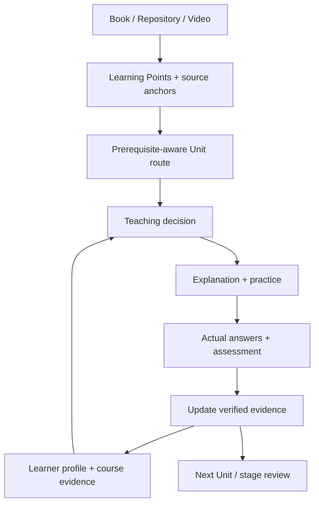

<p align="center"></p>
<h1 align="center">好好学习 · Study</h1>
<p align="center"><strong>Turn fast-changing AI knowledge into a personal, evidence-based learning path.</strong></p>
<p align="center"><a href="README.md">简体中文</a> · <a href="README.en.md">English</a> · <a href="#quick-start">Quick Start</a></p>
<p align="center">
  
  
  
</p>

## Why 好好学习 (Hao Hao Xue Xi)?

AI tools, frameworks and practices evolve quickly. A single book can be dense, a GitHub project can be unfamiliar, and a long video can hide important prerequisites. People bring different backgrounds to the same material.

**好好学习 (Study V3.5)** is an Agent Skill built around a simple learning loop: **read the actual source → identify Learning Points (LPs) → organize prerequisite-aware Units → teach according to the learner's profile → assess real understanding → continue from recorded progress.**

## Supported sources

| Input | How it is handled |
| --- | --- |
| Books, PDFs and documents | Recover contents, chapters, key concepts and source anchors; break material into LPs and Units |
| GitHub repositories | Begin with README and project structure; inspect relevant documentation, code and examples |
| Video links | Use reliable subtitles/transcripts or supported audio/video tools, retaining timestamps where available |
| Web pages and multiple documents | Preserve source provenance, concept relationships and missing-content boundaries |

Source access depends on the agent host. If reliable video content cannot be retrieved, the Skill reports that limitation instead of inferring the video from its title.

## First use: a learner profile

On a new learner's initial `/study` run, the workflow:

1. Asks for an English name or preferred English alias for a stable local profile path.
2. Creates or reads the learner profile in persistent storage if the host permits it.
3. Asks what source to learn and why.
4. Extracts and shows an initial concept map, including relevant prerequisites.
5. Checks the learner's familiarity with those concepts in accessible language.
6. Finalizes a route; `/study-n` starts the first Unit.

Over time, course evidence from answers and assessments helps adjust explanations, prerequisite bridges and next steps. The Skill distinguishes materials delivered from actual understanding demonstrated.



## Learning modes and commands

There are two main learning modes: **standard progression** (`/study`) and **deep exploration of one topic** (`/study-d`). The supporting commands handle navigation, clarification, assessment and consolidation.

| Command | Purpose | Example |
| --- | --- | --- |
| `/study [source]` | Start from a book, repository, video or other readable source; deliver a knowledge overview | `/study https://github.com/bojieli/ai-agent-book` |
| `/study-n` | Begin/continue the next unfinished Unit | `/study-n` |
| `/study-e <topic>` | Re-explain a specific difficulty; bridge required foundations | `/study-e What is an event loop?` |
| `/study-d <topic>` | Create a detailed, multi-page study module for one topic, with HTML output where supported | `/study-d async/await` |
| `/study-q <topic>` | Generate a mixed assessment (multiple choice, true/false, bounded scenario questions) | `/study-q Chapter 5` |
| `/study-c <topic>` | Consolidate generated lessons and available assessments into a single study resource | `/study-c Chapter 5` |
| `/study-m` | View the current knowledge map and learning position | `/study-m` |

The initial `/study` organizes the source and route; `/study-n` enters Unit 1.

## Quick Start

1. Download the repository from **Code → Download ZIP** and extract it.
2. Copy the entire `study/` directory into a Skills location supported by your agent host. The file `study/SKILL.md` must remain at that folder's top level.
3. In an environment supporting user-scoped Codex Skills, an example location is `~/.codex/skills/study/`.
4. After your agent recognizes the Skill, start with:

```text
/study https://github.com/bojieli/ai-agent-book
```

The actual installation procedure, source access, HTML rendering and persistent storage depend on the host. GitHub only stores and versions the Skill source.

## Project layout

```text
study/
├── SKILL.md
├── agents/
├── assets/
├── references/
├── schemas/
└── scripts/
    ├── study_home.py
    ├── study_check.py
    └── study_quiz_check.py
```

See [`study/SKILL.md`](study/SKILL.md), [`first-use.md`](study/references/first-use.md) and [`source-adapters.md`](study/references/source-adapters.md) for the detailed design.

## Learner data and safeguards

The default learner data root, where persistent file operations are allowed, is `~/Study/learners/<english-name>/`. A `learner-profile.json` carries background and summarized learning evidence, while each course's `study-state.json` records its own progress and authoritative assessment evidence. Keep personal histories outside the public repository. Skill installation does not itself sync learner data across devices.

Source-grounded teaching, conservative assessment, stable LP identifiers and resumable state are core design requirements. The bundled Python scripts validate structural contracts; educational correctness and fully rendered interactions require additional review.

No open-source `LICENSE` file has been selected for this distribution; confirm permissions and publication scope before public release.
