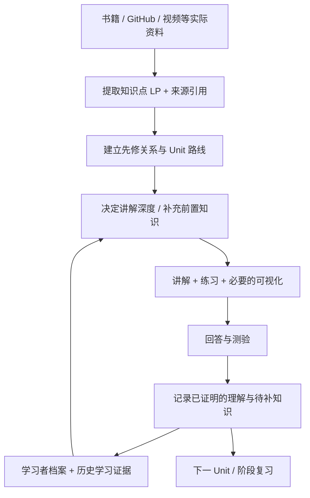

<p align="center">
  
</p>

<h1 align="center">好好学习 · Study</h1>

<p align="center"><strong>把快速变化的 AI 知识，变成适合自己的、可以真正掌握的学习路径。</strong></p>

<p align="center">
  <a href="README.md">简体中文</a> · <a href="README.en.md">English</a> · <a href="#快速开始">开始使用</a> · <a href="#学习模式与命令">学习模式</a>
</p>

<p align="center">
  
  
  
  
</p>

> **为什么做「好好学习」？**
>
> AI 技术更新越来越快。今天刚读懂一个概念，明天又出现新的 Agent 框架、工具或实践方法。书籍太厚、GitHub 项目太复杂、视频太长，学习者的基础和进度也各不相同。
>
> 我创建这个 Skill，希望把「找到资料 → 拆解知识 → 结合个人基础学习 → 通过测验确认理解 → 持续接着学」变成一个完整流程。

## 这是什么？

**好好学习（Study V3.5）** 是一个用于 AI Agent 的自适应学习 Skill。你可以给它一本书、一份 PDF、一个 GitHub 仓库链接，或者带有可读取内容的视频链接。它会基于实际读取的资料，先提取**知识点（Learning Points）**，梳理前置知识和依赖关系，再把知识点编排成适合逐步学习的 **Unit（学习单元）**。

第一次使用时，它会引导你建立**学习者档案**，了解你已有的知识、学习目标和适合的讲解方式。之后的课程根据你的实际回答、理解困难和测验结果调整教学内容；完成阶段考核后，更新相应学习记录。

**核心思路：知识点结构 × 学习者档案 × 实际掌握证据 → 下一步怎么教。**

## 支持哪些学习资料？

| 学习来源 | 它会怎样处理 | 举例 |
| --- | --- | --- |
| **书籍与文档** | 读取目录、章节、概念、表格和必要的图示，整理知识点及先修关系 | PDF / EPUB / Markdown / DOCX / 技术手册 |
| **GitHub 项目** | 从 README、目录结构、文档、相关代码和示例入手，把「项目在做什么、怎么实现」拆成可学习的单元 | `https://github.com/bojieli/ai-agent-book` |
| **视频链接** | 在有字幕、转录文本或宿主支持音视频读取时，结合时间戳和必要画面提取知识点 | YouTube 课程 / 技术演讲 / 教学视频 |
| **网页与多份资料** | 对应原文位置，识别不同资料间的关系，安排主线与补充材料 | 官方文档 / 技术文章 / 多章节内容 |

> **来源可信度原则：** 学习内容以实际可读取的原始资料为依据。视频如果无法取得可靠字幕、转录或必要画面，会明确标注资料缺口；不会根据标题猜测完整内容。

## 它怎样知道你需要学什么？

### ① 第一次：建立你的学习者档案

首次启动 `/study` 时，系统按顺序引导：

1. **询问英文姓名或常用英文名**，用于建立固定的本地档案目录。
2. **创建或读取学习者档案**，保存可复用的学习背景及偏好。
3. **询问学习材料与目标**，例如“读懂某本 Agent 书的第五章”。
4. **先整理知识地图**，展示有哪些知识点及其前置关系。
5. **了解你对相关概念的熟悉程度**，例如是否了解 Python、HTTP 或 SQL。
6. **生成学习路线**，之后使用 `/study-n` 进入第一单元。

例如，同样学习「事件循环」：初学者可能先了解“程序如何等待任务”；有 Python 基础的人可以直接进入 `async/await`、调度机制与代码练习。课程会结合实际反馈进一步调整，而非仅凭自报水平认定掌握。

### ② 学习中：知识点驱动，而非机械翻页



系统区分三个状态：**内容已经生成**、**课程已经讲到哪里**、**学习者实际证明理解了什么**。听完一课和通过相关测验会分别记录。对于薄弱知识点，它会补充必要的基础解释，再回到原来的学习主线。

### ③ 下次：从上次的位置继续

在可以持久保存文件的运行环境中，Study 会读取已有档案与课程状态，继续上次的 Unit。不同资料可复用相关学习背景，但新领域仍需要相应的学习证据。

默认本地目录示意：

```text
~/Study/
└── learners/
    └── <english-name>/
        ├── learner-profile.json          # 跨课程学习者档案
        └── courses/
            └── <course-id>/
                └── study-state.json       # 单门课程的进度与证据
```

个人档案与答题记录应保存在使用者自己的受控目录中，**无需上传到公开 GitHub 仓库**。跨设备继续学习需要迁移或同步这些状态文件，单独安装 Skill 并不自动同步个人记录。

## 学习模式与命令

Study 设计了两种核心学习模式，并用一组简短命令控制教学、复习和考核。

### 两种核心模式

| 模式 | 命令 | 适合什么情况 | 交付内容 |
| --- | --- | --- | --- |
| **标准学习模式** | `/study [资料]` | 系统学习一本书、一个 GitHub 项目或一门视频课程 | 知识地图、学习路线；之后逐个 Unit 教学 |
| **深度学习模式** | `/study-d <主题>` | 一个难点听过仍不清楚，希望从基础到细节彻底拆开 | 针对该主题的多页深入讲解、索引与覆盖检查（在支持 HTML 的环境中） |

> `/study` 先完成初次建档（如需要）、资料分析和学习路线，不会直接跳入 Unit 1。使用 `/study-n` 开始正式逐单元学习。

### 学习、解释、考试和整理

| 命令 | 作用 | 示例 |
| --- | --- | --- |
| `/study [source]` | 新建学习任务，拆知识点并制定路线 | `/study https://github.com/bojieli/ai-agent-book` |
| `/study-n` | 进入下一 Unit / 继续学习 | `/study-n` |
| `/study-e <topic>` | 针对具体困惑重新解释，按需补基础 | `/study-e 我完全不懂事件循环` |
| `/study-d <topic>` | 对某个主题展开深入的多页学习 | `/study-d Python async/await` |
| `/study-q <topic>` | 出测验：默认包含选择、判断和有边界的综合题 | `/study-q 第五章` |
| `/study-c <topic>` | 将已生成的课程资料、试卷、可用评估记录合并整理 | `/study-c 第五章` |
| `/study-m` | 查看知识地图、当前位置与待补知识 | `/study-m` |

**三个常见场景**

<details>
<summary><strong>场景 A：我想学习一本 AI Agent 书</strong></summary>

```text
/study https://github.com/bojieli/ai-agent-book
/study-n
/study-e 我不懂 KV Cache
/study-q 第二章
```

先拆章节和知识点，再学习、补充解释、做阶段测验。
</details>

<details>
<summary><strong>场景 B：我想看懂一个 GitHub 开源项目</strong></summary>

```text
/study https://github.com/某作者/某项目
/study-n
/study-d 项目的核心数据流
/study-m
```

从项目文档、结构和关键实现入手，逐步理解组件之间的关系。具体可分析范围以宿主工具能访问的项目文件为准。
</details>

<details>
<summary><strong>场景 C：我想学一段技术视频</strong></summary>

```text
/study https://www.youtube.com/watch?v=视频ID
/study-n
/study-c 当前章节
```

在字幕、转录或视频内容可读取时，按概念拆分，再整理已完成的学习材料。
</details>

## 快速开始

**1. 下载源码。** 点击仓库页面的 **Code → Download ZIP**，解压。

**2. 安装 Skill。** 将完整 `study/` 文件夹放到支持 Agent Skills 的工具所识别的 Skill 目录，确保 `SKILL.md` 在该文件夹顶层。

例如，支持用户级 Skills 目录的 Codex 环境可采用：

```text
~/.codex/skills/study/SKILL.md
```

具体安装、启用、网页访问和本地文件权限取决于使用的 Agent 宿主。

**3. 发起第一个学习任务。** 在已启用 Study 的 Agent 会话中输入：

```text
/study https://github.com/bojieli/ai-agent-book
```

按引导完成档案和知识地图后，输入 `/study-n` 开始第一课。此处的 `/study` 等命令由加载 Skill 的 Agent 识别和处理，GitHub 本身只负责存放项目源码。

## 项目目录

```text
study/
├── SKILL.md                 # 工作流入口、命令与核心规则
├── agents/
│   └── openai.yaml          # Agent 元数据
├── assets/                  # HTML 学习页面模板与图标
├── references/              # 首次使用、资料读取、教学、考试、恢复和 QA 规则
├── schemas/                 # 学习者档案、知识点、来源结构规范
└── scripts/
    ├── study_home.py        # 定位 / 初始化学习者档案
    ├── study_check.py       # 档案、课程状态与 HTML 结构检查
    └── study_quiz_check.py  # 测验数据结构检查
```

完整规则见 [`study/SKILL.md`](study/SKILL.md)。首次运行流程见 [`first-use.md`](study/references/first-use.md)，资料支持情况见 [`source-adapters.md`](study/references/source-adapters.md)。

## 设计原则与当前边界

- **依据原文教学：** 知识点保留来源位置，缺失的部分明确标记。
- **以证据更新档案：** 教学进度、个人自评和实际理解分别记录；阶段总结由测验及学习证据支持。
- **先补必要基础：** 按个人情况调整讲法，同时保留原资料的重要知识结构。
- **可恢复、可检查：** 提供本地状态和 Python 校验脚本；结构校验不等于教学质量已验证。
- **依赖运行环境：** 网页读取、视频字幕、HTML 交互和文件持久化由宿主能力决定。

本项目当前为 **V3.5**。公开发布前请确认第三方资料的引用、项目许可和个人数据的隔离范围；代码包目前未附带开源授权文件。

---

<p align="center"><strong>好好学习，让每一次学习都建立在上一次真正理解的基础上。</strong></p>
